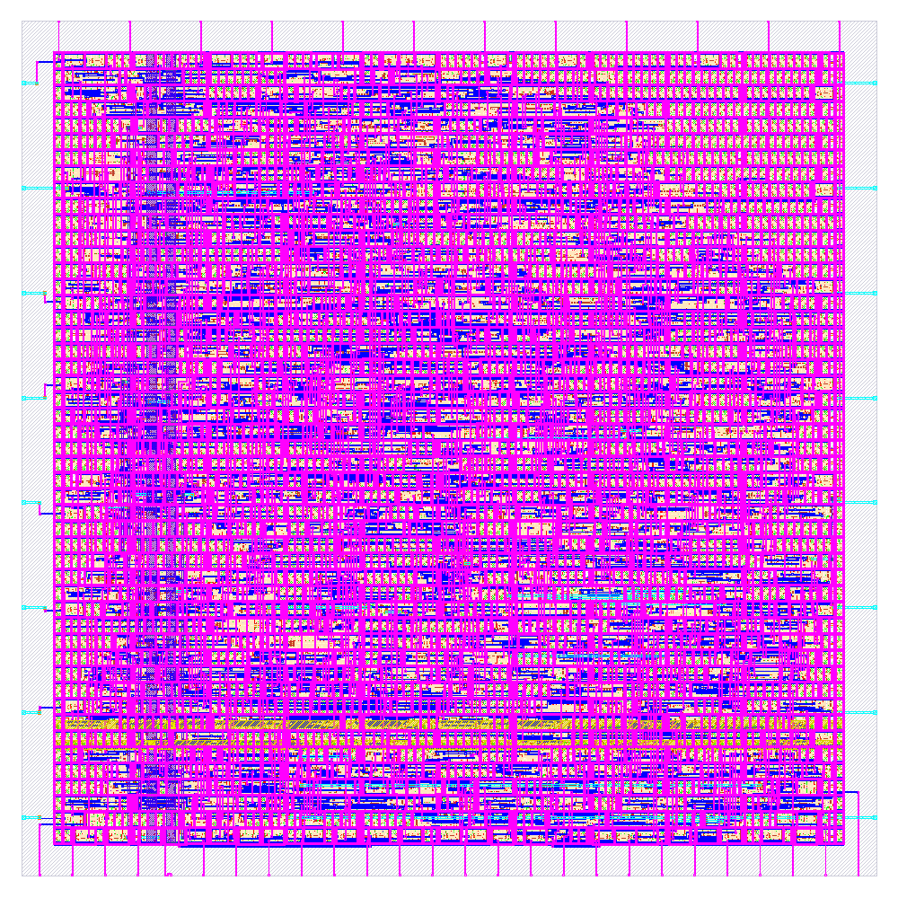
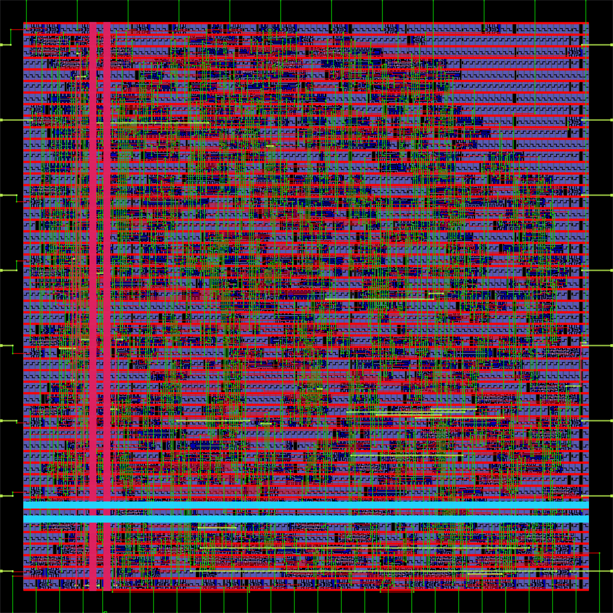
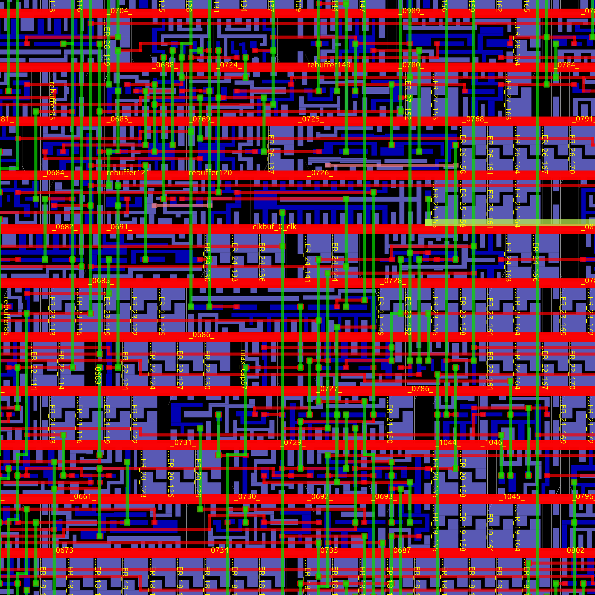

# mac_pe — Pipelined MAC Processing Element

**Target:** SkyWater `sky130A` / `sky130_fd_sc_hd` · **Flow:** [LibreLane](https://github.com/librelane/librelane) 3.0.16 (`Classic`) + [OpenROAD](https://theopenroadproject.org/) · **Status:** signoff ✅


A single multiply-accumulate processing element for a systolic-array MAC,
hardened as a **square, tileable compute block**. The RTL is untouched:
`PIPELINE_MAC=1` is delivered as a Yosys parameter, producing the pipeline
`[hop regs] | [mult] | [add] | [acc]` (the product lands one clock after its
operands are registered).

<p align="center">
  
  <br>
  <em>Final GDS — KLayout signoff render (run <code>sq1s740</code>)</em>
</p>

| OpenROAD view of the final ODB | Detail (30 × 30 µm, stdcells + met1/met2 + clock tree) |
|---|---|
|  |  |

*Both OpenROAD images were rendered directly from the delivered database
(`final/odb/mac_pe.odb`) with `save_image` — the exact silicon state committed
in this repo.*

## Final results — run `sq1s740`

| Metric | Value |
|---|---|
| **Signoff clock period** | **7.40 ns → 135.14 MHz** (claim = measured requirement + 0.043 ns margin) |
| Timing corners | setup + hold **MET at all 9 corners** (max/nom/min × SS/TT/FF); worst setup WS **+0.0433 ns** @ `max_ss_100C_1v60`, worst hold WS +0.231 ns; TNS = 0 everywhere |
| Die / core | **144.16 × 144.16 µm square** (20 782 µm²), core aspect ratio 1.003 (also square), row-aligned |
| Instances / utilization | 3 396 · 56.2 % core utilization |
| Power | **2.03 mW** (vectorless @ TT, 1.8 V) |
| Physical verification | magic DRC 0 · KLayout DRC 0 · XOR 0 · antenna 0 · LVS *"Circuits match uniquely"* · detailed-route DRC 0 · flow errors 0 |
| Max fmax corners | SS 135.9 MHz · TT 258–264 MHz · FF 403–412 MHz |

Deliverables of the run are committed under
[`librelane_flow_pd/runs/sq1s740/final/`](librelane_flow_pd/runs/sq1s740/final/)
— `odb/`, `def/`, `gds/`, `lef/`, `mag/`, `sdc/`, `sdf/`, `spef/`, `lib/`,
`spice/`, `metrics.json`.

## Floorplan contract

A systolic-array tile: **operands in on West + North, results out on East +
South**, so neighboring tiles abut with straight wires.

| Side | Pins | Contents |
|---|---|---|
| West | 8 | `a_in` (operand hop-in) |
| East | 8 | `a_out` (operand hop-out — W/E symmetric, track-aligned ⇒ straight wire) |
| North | 12 | `b_in` + control |
| South | 26 | `b_out` + `psum_out` |

## Optimization story (one knob per run, evidence-backed)

| Lever | Result |
|---|---|
| Synthesis strategy study (`CLOCK_PERIOD` proved inert at synth — measured, not assumed) | `DELAY 1` + `SYNTH_ABC_BUFFERING` → ABC delay **−33 %** vs default at +6 % area |
| Period ladder 6.0 → 7.75 ns | `max_ss_100C_1v60` identified as the binding corner; `repair_timing` plateau diagnosed |
| Over-constrained PnR (repair @ 6.0 ns) + honest signoff claim | first **all-green** signoff; predictions matched measurements 4/4 times |
| Area pass `FP_CORE_UTIL 41 / PL_TARGET_DENSITY_PCT 50` | die **−24.5 %** *and* 0.24 ns faster (shorter wires beat density penalty) |
| Square freeze `DIE_AREA 144.16²` | row-aligned square die + square core, another −8.3 % die → final claim **7.40 ns** |

Full decision log with run-by-run receipts: [`03_RESULTS.md`](librelane_flow_pd/docs/03_RESULTS.md).

## Repository layout

```
.
├── librelane_flow_pd/
│   ├── config.yaml            # LibreLane config (final sq1s740 state)
│   ├── impl.sdc               # PnR STA constraints (6.0 ns repair target)
│   ├── signoff.sdc            # signoff STA constraints (7.40 ns claim)
│   ├── pin_order.cfg          # per-side pin ordering
│   ├── rtl/                   # mac_pe.v, mult8x8_array.v (unmodified RTL)
│   ├── scripts/sweep_period.sh# period-sweep helper (edits all 3 period places)
│   ├── docs/                  # plan, floorplan guide, runbook, results
│   └── runs/sq1s740/          # FINAL run: all 76 step receipts + final/
└── README.md
```

## Reproducing the flow

The flow runs inside a nix devshell (LibreLane 3.0.16 + OpenROAD, PDK
resolved locally via ciel):

```bash
cd <difetto-flake-dir> && nix develop
cd <workspace-root>
python3 -m librelane designs/mac/librelane_flow_pd/config.yaml \
    --run-tag sq1s740 --flow Classic
```

See [`02_RUNBOOK.md`](librelane_flow_pd/docs/02_RUNBOOK.md) for the environment
rules, the period-change checklist (3 places), and known-benign warnings.

## Documentation

| Doc | Contents |
|---|---|
| [`00_PLAN.md`](librelane_flow_pd/docs/00_PLAN.md) | goals, phases, risk list, decision log |
| [`01_FLOORPLAN_GUIDE.md`](librelane_flow_pd/docs/01_FLOORPLAN_GUIDE.md) | square-tile geometry and pin-placement rules |
| [`02_RUNBOOK.md`](librelane_flow_pd/docs/02_RUNBOOK.md) | exact commands, checklists, troubleshooting |
| [`03_RESULTS.md`](librelane_flow_pd/docs/03_RESULTS.md) | every measured number, per run tag |

## Notes

* Only the final run (`sq1s740`) is published; intermediate runs and
  sibling projects are git-ignored. The period-optimal non-square variant
  (`a41s735`, 7.35 ns / 136.05 MHz) is documented in `03_RESULTS.md`.
* Images in `librelane_flow_pd/docs/images/` are regenerated from the
  committed ODB via OpenROAD:
  `save_image -area {0 0 144.16 144.16} -width 2400 <out>.png`.
